# Master Database Schema & ERD: SPARTA-HARGA (`PostgreSQL + Prisma 7`)

> [!IMPORTANT]
> Dokumen ini memuat spesifikasi skema database relasional **PostgreSQL** dengan standar enterprise:
> 1. **Model & Field Mapping**: Seluruh model (`PascalCase`) di-mapping ke nama tabel **`snake_case`** (`@@map("...")`), dan seluruh field (`camelCase`) di-mapping ke nama kolom **`snake_case`** (`@map("...")`).
> 2. **Explicit Constraint Naming**: Semua kunci diberi nama eksplisit standar enterprise:
>    - Primary Key: `pk_<tabel>`
>    - Foreign Key: `fk_<tabel>_<referensi>`
>    - Unique Constraint: `uq_<tabel>_<kolom>`
>    - Index Performa: `idx_<tabel>_<kolom>`
> 3. **Pragmatis & Cepat**: Tanpa *CHECK constraints* kustom untuk saat ini agar proses inisialisasi, migrasi, dan *seeding* berjalan cepat tanpa hambatan.
> *(File `prisma/schema.prisma` belum diubah).*

---

## 1. Entity-Relationship Diagram (ERD)

```mermaid
erDiagram
    divisi ||--o{ master_item : "memiliki item spesifikasi"
    divisi ||--o{ master_koefisien : "pustaka komponen baku"
    divisi ||--o{ pengajuan_harga : "divisi pengaju"
    divisi ||--o{ kontraktor_cabang : "spesialisasi rekanan"
    divisi ||--o{ users : "divisi tugas staf"

    cabang ||--o{ wilayah_cabang : "membawahi wilayah"
    cabang ||--o{ users : "cabang homebase staf"
    cabang ||--o{ user_cabang_coverage : "wewenang approval cabang"
    users ||--o{ user_cabang_coverage : "memiliki wewenang cabang"

    cabang ||--o{ master_toko : "toko acuan cabang"
    cabang ||--o{ kontraktor_cabang : "memiliki rekanan"
    wilayah_cabang |o--o{ master_toko : "lokasi wilayah toko"

    kontraktor ||--o{ kontraktor_cabang : "beroperasi di cabang"
    kontraktor ||--o{ users : "akun vendor rekanan"

    master_item ||--o{ master_harga_cabang : "harga standar induk"
    cabang ||--o{ master_harga_cabang : "berlaku di induk"
    master_harga_cabang ||--o{ master_harga_wilayah : "harga override wilayah"
    wilayah_cabang ||--o{ master_harga_wilayah : "berlaku di wilayah"

    cabang ||--o{ pengajuan_harga : "diajukan untuk cabang"
    wilayah_cabang |o--o{ pengajuan_harga : "diajukan untuk wilayah (jika beda)"
    master_item |o--o{ pengajuan_harga : "referensi item"
    users ||--o{ pengajuan_harga : "dibuat oleh"

    pengajuan_harga ||--o{ rincian_ahsp_pengajuan : "rincian komponen"
    master_koefisien ||--o{ rincian_ahsp_pengajuan : "dipilih via combobox"
    rincian_ahsp_pengajuan ||--o{ survei_toko_item : "survei 3 toko (material)"
    master_toko |o--o{ survei_toko_item : "toko yang disurvei"
    survei_toko_item ||--o{ lampiran_survei : "berkas nota & foto toko"

    pengajuan_harga ||--o{ voting_kontraktor : "kuorum penawaran"
    kontraktor_cabang ||--o{ voting_kontraktor : "partisipan kuorum"
    voting_kontraktor ||--o{ lampiran_banding : "bukti pasar"
    pengajuan_harga ||--o{ approval_audit_log : "jejak audit status"
    users ||--o{ approval_audit_log : "aktor pembuat aksi"

    divisi {
        string id PK "pk_divisi"
        string kode_divisi UK "uq_divisi_kode_divisi"
        string nama_divisi
        boolean is_active
    }

    cabang {
        string id PK "pk_cabang"
        string kode_cabang UK "uq_cabang_kode_cabang"
        string nama_cabang
        string regional
        boolean is_active
    }

    wilayah_cabang {
        string id PK "pk_wilayah_cabang"
        string cabang_id FK "fk_wilayah_cabang_cabang"
        string kode_wilayah UK "uq_wilayah_cabang_kode_wilayah"
        string nama_wilayah
        string keterangan_lokasi
        boolean is_active
    }

    users {
        string id PK "pk_users"
        string email UK "uq_users_email (anchor whitelist)"
        string full_name
        string branch_name
        string role
        string divisi_id FK "fk_users_divisi"
        string cabang_id FK "fk_users_cabang"
        string kontraktor_id FK "fk_users_kontraktor"
        boolean is_active
        datetime last_synced_at
    }

    user_cabang_coverage {
        string id PK "pk_user_cabang_coverage"
        string user_id FK "fk_user_cabang_coverage_user"
        string cabang_id FK "fk_user_cabang_coverage_cabang"
    }

    kontraktor {
        string id PK "pk_kontraktor"
        string kode_vendor UK "uq_kontraktor_kode_vendor"
        string nama_perusahaan
        string pic_name
        string telepon
        string email UK "uq_kontraktor_email"
        string alamat_kantor
    }

    kontraktor_cabang {
        string id PK "pk_kontraktor_cabang"
        string kontraktor_id FK "fk_kontraktor_cabang_kontraktor"
        string cabang_id FK "fk_kontraktor_cabang_cabang"
        string divisi_id FK "fk_kontraktor_cabang_divisi"
        string status_keaktifan
        datetime tanggal_terdaftar
        datetime parked_at
        string alasan_parked
        string item_pemicu_kode
        datetime unparked_at
        string unparked_by
        string unpark_reason
    }

    master_toko {
        string id PK "pk_master_toko"
        string cabang_id FK "fk_master_toko_cabang"
        string wilayah_cabang_id FK "fk_master_toko_wilayah"
        string nama_toko
        string alamat
        string kota
        string kontak_pic
        string telepon
        boolean is_active
    }

    master_item {
        string id PK "pk_master_item"
        string divisi_id FK "fk_master_item_divisi"
        string kode_item
        string kode_varian
        string kode_master UK "uq_master_item_kode_master"
        string kategori
        string nama_item
        string ukuran
        string merk
        string warna
        string tipe
        string permukaan
        string tebal
        string lokasi
        string satuan
        text deskripsi_otomatis
    }

    master_koefisien {
        string id PK "pk_master_koefisien"
        string divisi_id FK "fk_master_koefisien_divisi"
        string kategori_komponen
        string nama_komponen
        string satuan
        decimal nilai_koefisien_default
        decimal harga_acuan_default
        boolean wajib_survei_toko
        boolean is_active
    }

    master_harga_cabang {
        string id PK "pk_master_harga_cabang"
        string master_item_id FK "fk_master_harga_cabang_item"
        string cabang_id FK "fk_master_harga_cabang_cabang"
        string pengajuan_terakhir_id FK "fk_master_harga_cabang_pengajuan"
        decimal harga_final_induk
        decimal margin_total_persen
        string status_harga
        datetime berlaku_sejak
    }

    master_harga_wilayah {
        string id PK "pk_master_harga_wilayah"
        string master_harga_cabang_id FK "fk_master_harga_wilayah_induk"
        string wilayah_cabang_id FK "fk_master_harga_wilayah_wilayah"
        string pengajuan_terakhir_id FK "fk_master_harga_wilayah_pengajuan"
        decimal harga_final_wilayah
        decimal selisih_dari_induk_rp
        decimal selisih_dari_induk_persen
        string status_harga
        datetime berlaku_sejak
    }

    pengajuan_harga {
        string id PK "pk_pengajuan_harga"
        string nomor_tiket UK "uq_pengajuan_harga_nomor_tiket"
        string divisi_id FK "fk_pengajuan_harga_divisi"
        string cabang_id FK "fk_pengajuan_harga_cabang"
        string wilayah_cabang_id FK "fk_pengajuan_harga_wilayah"
        string master_item_id FK "fk_pengajuan_harga_item"
        string pembuat_user_id FK "fk_pengajuan_harga_user"
        string cakupan_harga
        string status
        boolean is_termasuk_bongkaran
        decimal rata_rata_survei_material
        decimal margin_awal_persen
        boolean is_hasil_negosiasi
        decimal margin_snb_persen
        decimal harga_ditetapkan_snb
        datetime deadline_voting
        datetime tanggal_pengajuan
    }

    rincian_ahsp_pengajuan {
        string id PK "pk_rincian_ahsp_pengajuan"
        string pengajuan_harga_id FK "fk_rincian_ahsp_pengajuan_pengajuan"
        string master_koefisien_id FK "fk_rincian_ahsp_pengajuan_koefisien"
        string nama_komponen
        string kategori_komponen
        string satuan
        decimal nilai_koefisien
        decimal harga_acuan_satuan
        decimal margin_persen
        decimal subtotal
    }

    survei_toko_item {
        string id PK "pk_survei_toko_item"
        string rincian_ahsp_id FK "fk_survei_toko_item_rincian"
        string master_toko_id FK "fk_survei_toko_item_toko"
        int urutan_toko
        string nama_toko
        string alamat_toko
        decimal volume_acuan
        decimal harga_satuan_survei
        datetime tanggal_survei
        string catatan_survei
    }

    lampiran_survei {
        string id PK "pk_lampiran_survei"
        string survei_toko_id FK "fk_lampiran_survei_survei"
        string jenis_lampiran
        string nama_file
        string file_url
        string ukuran_file
        datetime uploaded_at
    }

    voting_kontraktor {
        string id PK "pk_voting_kontraktor"
        string pengajuan_harga_id FK "fk_voting_kontraktor_pengajuan"
        string kontraktor_cabang_id FK "fk_voting_kontraktor_kontraktor_cabang"
        int putaran_vote
        string status_vote
        decimal usulan_harga
        decimal usulan_margin_persen
        text catatan_penolakan
        boolean has_rejected_once
        datetime tanggal_respon
    }

    lampiran_banding {
        string id PK "pk_lampiran_banding"
        string voting_kontraktor_id FK "fk_lampiran_banding_voting"
        string nama_file
        string file_url
        string ukuran_file
        datetime uploaded_at
    }

    approval_audit_log {
        string id PK "pk_approval_audit_log"
        string pengajuan_harga_id FK "fk_approval_audit_log_pengajuan"
        string user_id FK "fk_approval_audit_log_user"
        string role_actor
        string action
        text catatan
        datetime created_at
    }
```



---

## 2. Struktur Skema Prisma dengan Full Mapping & Explicit Constraint Keys

Berikut rancangan skema Prisma lengkap yang memetakan seluruh nama tabel (`@@map`), kolom (`@map`), dan nama kunci (`pk_`, `fk_`, `uq_`, `idx_`):

```prisma
generator client {
  provider = "prisma-client-js"
}

datasource db {
  provider = "postgresql"
  url      = env("DATABASE_URL")
}

// ============================================================================
// ENUMS (NATIVE POSTGRES ENUMS VIA @map)
// ============================================================================

enum RoleUser {
  BUILDING_COORDINATOR @map("BUILDING_COORDINATOR")
  BM_MANAGER           @map("BM_MANAGER")
  PP_MANAGER           @map("PP_MANAGER")
  SB_SPECIALIST        @map("SB_SPECIALIST")
  REGIONAL_MANAGER     @map("REGIONAL_MANAGER")
  KONTRAKTOR           @map("KONTRAKTOR")
  ADMIN                @map("ADMIN")

  @@map("role_user")
}

enum StatusKeaktifanCabang {
  AKTIF              @map("AKTIF")
  NONAKTIF_SEMENTARA @map("NONAKTIF_SEMENTARA")
  BLACKLIST          @map("BLACKLIST")

  @@map("status_keaktifan_cabang")
}

enum StatusHargaCabang {
  AKTIF    @map("AKTIF")
  NONAKTIF @map("NONAKTIF")

  @@map("status_harga_cabang")
}

enum CakupanHarga {
  INDUK_CABANG   @map("INDUK_CABANG")
  KHUSUS_WILAYAH @map("KHUSUS_WILAYAH")

  @@map("cakupan_harga")
}

enum StatusPengajuanHarga {
  DRAFT               @map("DRAFT")
  DIAJUKAN            @map("DIAJUKAN")
  SIAP_SURVEI         @map("SIAP_SURVEI")
  PENDING_BM_MGR      @map("PENDING_BM_MGR")
  PENDING_SB_SPECIALIST @map("PENDING_SB_SPECIALIST")
  PENDING_REGIONAL_MGR  @map("PENDING_REGIONAL_MGR")
  PENDING_KONTRAKTOR  @map("PENDING_KONTRAKTOR")
  USULAN_KONTRAKTOR   @map("USULAN_KONTRAKTOR")
  DITOLAK_KONTRAKTOR  @map("DITOLAK_KONTRAKTOR")
  PERLU_REVISI        @map("PERLU_REVISI")
  RETURNED_TO_BC      @map("RETURNED_TO_BC")
  DITOLAK             @map("DITOLAK")
  RELEASED            @map("RELEASED")

  @@map("status_pengajuan_harga")
}

enum StatusVoteKontraktor {
  MENUNGGU @map("MENUNGGU")
  SETUJU   @map("SETUJU")
  TOLAK    @map("TOLAK")
  TIMEOUT  @map("TIMEOUT")

  @@map("status_vote_kontraktor")
}

// ============================================================================
// 1. ORGANISASI: DIVISI, CABANG & WILAYAH
// ============================================================================

model Divisi {
  id         String   @id(map: "pk_divisi") @default(cuid()) @map("id")
  kodeDivisi String   @unique(map: "uq_divisi_kode_divisi") @map("kode_divisi")
  namaDivisi String   @map("nama_divisi")
  isActive   Boolean  @default(true) @map("is_active")
  createdAt  DateTime @default(now()) @map("created_at")
  updatedAt  DateTime @updatedAt @map("updated_at")

  masterItems       MasterItem[]
  masterKoefisiens  MasterKoefisien[]
  pengajuanHargaList PengajuanHarga[]
  kontraktorCabangs KontraktorCabang[]
  users             User[]

  @@map("divisi")
}

model Cabang {
  id         String   @id(map: "pk_cabang") @default(cuid()) @map("id")
  kodeCabang String   @unique(map: "uq_cabang_kode_cabang") @map("kode_cabang")
  namaCabang String   @map("nama_cabang")
  regional   String   @map("regional")
  isActive   Boolean  @default(true) @map("is_active")
  createdAt  DateTime @default(now()) @map("created_at")
  updatedAt  DateTime @updatedAt @map("updated_at")

  wilayahList       WilayahCabang[]
  users             User[]
  userCoverages     UserCabangCoverage[]
  kontraktorRelasi  KontraktorCabang[]
  masterTokoList    MasterToko[]
  masterHargaList   MasterHargaCabang[]
  pengajuanHargaList PengajuanHarga[]

  @@map("cabang")
}

model WilayahCabang {
  id               String   @id(map: "pk_wilayah_cabang") @default(cuid()) @map("id")
  cabangId         String   @map("cabang_id")
  kodeWilayah      String   @unique(map: "uq_wilayah_cabang_kode_wilayah") @map("kode_wilayah")
  namaWilayah      String   @map("nama_wilayah")
  keteranganLokasi String?  @map("keterangan_lokasi")
  isActive         Boolean  @default(true) @map("is_active")
  createdAt        DateTime @default(now()) @map("created_at")
  updatedAt        DateTime @updatedAt @map("updated_at")

  cabang             Cabang               @relation(fields: [cabangId], references: [id], onDelete: Cascade, map: "fk_wilayah_cabang_cabang")
  masterTokoList     MasterToko[]
  masterHargaWilayah MasterHargaWilayah[]
  pengajuanHargaList PengajuanHarga[]

  @@index([cabangId], map: "idx_wilayah_cabang_cabang_id")
  @@map("wilayah_cabang")
}

// ============================================================================
// 2. USERS (SSO WHITELIST) & USER COVERAGE
// ============================================================================

model User {
  id           String    @id(map: "pk_users") @default(cuid()) @map("id")
  email        String    @unique(map: "uq_users_email") @map("email")
  fullName     String    @map("full_name")
  branchName   String?   @map("branch_name")
  role         RoleUser  @default(BUILDING_COORDINATOR) @map("role")
  divisiId     String?   @map("divisi_id")
  cabangId     String?   @map("cabang_id")
  kontraktorId String?   @map("kontraktor_id")
  isActive     Boolean   @default(true) @map("is_active")
  lastSyncedAt DateTime? @map("last_synced_at")
  createdAt    DateTime  @default(now()) @map("created_at")
  updatedAt    DateTime  @updatedAt @map("updated_at")

  divisi             Divisi?              @relation(fields: [divisiId], references: [id], onDelete: SetNull, map: "fk_users_divisi")
  cabang             Cabang?              @relation(fields: [cabangId], references: [id], onDelete: SetNull, map: "fk_users_cabang")
  kontraktor         Kontraktor?          @relation(fields: [kontraktorId], references: [id], onDelete: SetNull, map: "fk_users_kontraktor")
  coverages          UserCabangCoverage[]
  pengajuanHargaList PengajuanHarga[]
  auditLogs          ApprovalAuditLog[]

  @@index([role, isActive], map: "idx_users_role_is_active")
  @@index([cabangId], map: "idx_users_cabang_id")
  @@map("users")
}

model UserCabangCoverage {
  id        String   @id(map: "pk_user_cabang_coverage") @default(cuid()) @map("id")
  userId    String   @map("user_id")
  cabangId  String   @map("cabang_id")
  createdAt DateTime @default(now()) @map("created_at")

  user   User   @relation(fields: [userId], references: [id], onDelete: Cascade, map: "fk_user_cabang_coverage_user")
  cabang Cabang @relation(fields: [cabangId], references: [id], onDelete: Cascade, map: "fk_user_cabang_coverage_cabang")

  @@unique([userId, cabangId], map: "uq_user_cabang_coverage_user_cabang")
  @@map("user_cabang_coverage")
}

// ============================================================================
// 3. REKANAN KONTRAKTOR & KONTRAKTOR CABANG
// ============================================================================

model Kontraktor {
  id             String   @id(map: "pk_kontraktor") @default(cuid()) @map("id")
  kodeVendor     String   @unique(map: "uq_kontraktor_kode_vendor") @map("kode_vendor")
  namaPerusahaan String   @map("nama_perusahaan")
  picName        String   @map("pic_name")
  telepon        String   @map("telepon")
  email          String   @unique(map: "uq_kontraktor_email") @map("email")
  alamatKantor   String?  @map("alamat_kantor")
  createdAt      DateTime @default(now()) @map("created_at")
  updatedAt      DateTime @updatedAt @map("updated_at")

  users        User[]
  cabangRelasi KontraktorCabang[]

  @@map("kontraktor")
}

model KontraktorCabang {
  id               String                @id(map: "pk_kontraktor_cabang") @default(cuid()) @map("id")
  kontraktorId     String                @map("kontraktor_id")
  cabangId         String                @map("cabang_id")
  divisiId         String                @map("divisi_id")
  statusKeaktifan  StatusKeaktifanCabang @default(AKTIF) @map("status_keaktifan")
  tanggalTerdaftar DateTime              @default(now()) @map("tanggal_terdaftar")
  parkedAt         DateTime?             @map("parked_at")
  alasanParked     String?               @map("alasan_parked")
  itemPemicuKode   String?               @map("item_pemicu_kode")
  unparkedAt       DateTime?             @map("unparked_at")
  unparkedBy       String?               @map("unparked_by")
  unparkReason     String?               @map("unpark_reason")
  createdAt        DateTime              @default(now()) @map("created_at")
  updatedAt        DateTime              @updatedAt @map("updated_at")

  kontraktor         Kontraktor         @relation(fields: [kontraktorId], references: [id], onDelete: Cascade, map: "fk_kontraktor_cabang_kontraktor")
  cabang             Cabang             @relation(fields: [cabangId], references: [id], onDelete: Cascade, map: "fk_kontraktor_cabang_cabang")
  divisi             Divisi             @relation(fields: [divisiId], references: [id], onDelete: Cascade, map: "fk_kontraktor_cabang_divisi")
  votingPartisipasi  VotingKontraktor[]

  @@unique([kontraktorId, cabangId, divisiId], map: "uq_kontraktor_cabang_divisi")
  @@index([cabangId, statusKeaktifan], map: "idx_kontraktor_cabang_status")
  @@map("kontraktor_cabang")
}

// ============================================================================
// 4. MASTER TOKO, MASTER ITEM & MASTER KOEFISIEN (COMBOBOX)
// ============================================================================

model MasterToko {
  id               String   @id(map: "pk_master_toko") @default(cuid()) @map("id")
  cabangId         String   @map("cabang_id")
  wilayahCabangId  String?  @map("wilayah_cabang_id")
  namaToko         String   @map("nama_toko")
  alamat           String   @map("alamat")
  kota             String   @map("kota")
  kontakPic        String?  @map("kontak_pic")
  telepon          String?  @map("telepon")
  isActive         Boolean  @default(true) @map("is_active")
  createdAt        DateTime @default(now()) @map("created_at")
  updatedAt        DateTime @updatedAt @map("updated_at")

  cabang        Cabang          @relation(fields: [cabangId], references: [id], onDelete: Cascade, map: "fk_master_toko_cabang")
  wilayahCabang WilayahCabang?  @relation(fields: [wilayahCabangId], references: [id], onDelete: SetNull, map: "fk_master_toko_wilayah")
  surveiList    SurveiTokoItem[]

  @@index([cabangId], map: "idx_master_toko_cabang_id")
  @@map("master_toko")
}

model MasterItem {
  id                String   @id(map: "pk_master_item") @default(cuid()) @map("id")
  divisiId          String   @map("divisi_id")
  kodeItem          String   @map("kode_item")
  kodeVarian        String   @map("kode_varian")
  kodeMaster        String   @unique(map: "uq_master_item_kode_master") @map("kode_master")
  kategori          String   @map("kategori")
  namaItem          String   @map("nama_item")
  ukuran            String   @map("ukuran")
  merk              String   @map("merk")
  warna             String?  @map("warna")
  tipe              String?  @map("tipe")
  permukaan         String?  @map("permukaan")
  tebal             String?  @map("tebal")
  toleransi         String?  @map("toleransi")
  lokasi            String   @map("lokasi")
  satuan            String   @map("satuan")
  deskripsiOtomatis String   @map("deskripsi_otomatis")
  createdAt         DateTime @default(now()) @map("created_at")
  updatedAt         DateTime @updatedAt @map("updated_at")

  divisi             Divisi              @relation(fields: [divisiId], references: [id], onDelete: Cascade, map: "fk_master_item_divisi")
  hargaPerCabang     MasterHargaCabang[]
  pengajuanHargaList PengajuanHarga[]

  @@unique([kodeItem, kodeVarian], map: "uq_master_item_kode_varian")
  @@index([divisiId, kategori], map: "idx_master_item_divisi_kategori")
  @@map("master_item")
}

model MasterKoefisien {
  id                    String   @id(map: "pk_master_koefisien") @default(cuid()) @map("id")
  divisiId              String   @map("divisi_id")
  kategoriKomponen      String   @map("kategori_komponen")
  namaKomponen          String   @map("nama_komponen")
  satuan                String   @map("satuan")
  nilaiKoefisienDefault Decimal  @db.Decimal(10, 4) @map("nilai_koefisien_default")
  hargaAcuanDefault     Decimal? @db.Decimal(15, 2) @map("harga_acuan_default")
  wajibSurveiToko       Boolean  @default(false) @map("wajib_survei_toko")
  isActive              Boolean  @default(true) @map("is_active")
  createdAt             DateTime @default(now()) @map("created_at")
  updatedAt             DateTime @updatedAt @map("updated_at")

  divisi       Divisi                 @relation(fields: [divisiId], references: [id], onDelete: Cascade, map: "fk_master_koefisien_divisi")
  rincianAHSP  RincianAhspPengajuan[]

  @@index([divisiId, kategoriKomponen], map: "idx_master_koefisien_divisi_kategori")
  @@map("master_koefisien")
}

// ============================================================================
// 5. MASTER HARGA CABANG & MASTER HARGA WILAYAH
// ============================================================================

model MasterHargaCabang {
  id                   String            @id(map: "pk_master_harga_cabang") @default(cuid()) @map("id")
  masterItemId         String            @map("master_item_id")
  cabangId             String            @map("cabang_id")
  pengajuanTerakhirId  String?           @map("pengajuan_terakhir_id")
  hargaFinalInduk      Decimal           @db.Decimal(15, 2) @map("harga_final_induk")
  marginTotalPersen    Decimal           @default(8.00) @db.Decimal(5, 2) @map("margin_total_persen")
  statusHarga          StatusHargaCabang @default(AKTIF) @map("status_harga")
  berlakuSejak         DateTime          @default(now()) @map("berlaku_sejak")
  updatedAt            DateTime          @updatedAt @map("updated_at")

  masterItem           MasterItem           @relation(fields: [masterItemId], references: [id], onDelete: Cascade, map: "fk_master_harga_cabang_item")
  cabang               Cabang               @relation(fields: [cabangId], references: [id], onDelete: Cascade, map: "fk_master_harga_cabang_cabang")
  pengajuanTerakhir    PengajuanHarga?      @relation(fields: [pengajuanTerakhirId], references: [id], onDelete: SetNull, map: "fk_master_harga_cabang_pengajuan")
  masterHargaWilayah   MasterHargaWilayah[]

  @@unique([masterItemId, cabangId], map: "uq_master_harga_cabang_item_cabang")
  @@index([cabangId, statusHarga], map: "idx_master_harga_cabang_status")
  @@map("master_harga_cabang")
}

model MasterHargaWilayah {
  id                   String            @id(map: "pk_master_harga_wilayah") @default(cuid()) @map("id")
  masterHargaCabangId  String            @map("master_harga_cabang_id")
  wilayahCabangId      String            @map("wilayah_cabang_id")
  pengajuanTerakhirId  String?           @map("pengajuan_terakhir_id")
  hargaFinalWilayah    Decimal           @db.Decimal(15, 2) @map("harga_final_wilayah")
  selisihDariIndukRp   Decimal           @db.Decimal(15, 2) @map("selisih_dari_induk_rp")
  selisihDariIndukPersen Decimal         @db.Decimal(5, 2) @map("selisih_dari_induk_persen")
  statusHarga          StatusHargaCabang @default(AKTIF) @map("status_harga")
  berlakuSejak         DateTime          @default(now()) @map("berlaku_sejak")
  updatedAt            DateTime          @updatedAt @map("updated_at")

  masterHargaCabang    MasterHargaCabang @relation(fields: [masterHargaCabangId], references: [id], onDelete: Cascade, map: "fk_master_harga_wilayah_induk")
  wilayahCabang        WilayahCabang     @relation(fields: [wilayahCabangId], references: [id], onDelete: Cascade, map: "fk_master_harga_wilayah_wilayah")
  pengajuanTerakhir    PengajuanHarga?   @relation(fields: [pengajuanTerakhirId], references: [id], onDelete: SetNull, map: "fk_master_harga_wilayah_pengajuan")

  @@unique([masterHargaCabangId, wilayahCabangId], map: "uq_master_harga_wilayah_induk_wilayah")
  @@index([wilayahCabangId, statusHarga], map: "idx_master_harga_wilayah_status")
  @@map("master_harga_wilayah")
}

// ============================================================================
// 6. PENGAJUAN HARGA & RINCIAN AHSP
// ============================================================================

model PengajuanHarga {
  id                     String               @id(map: "pk_pengajuan_harga") @default(cuid()) @map("id")
  nomorTiket             String               @unique(map: "uq_pengajuan_harga_nomor_tiket") @map("nomor_tiket")
  divisiId               String               @map("divisi_id")
  cabangId               String               @map("cabang_id")
  wilayahCabangId        String?              @map("wilayah_cabang_id")
  masterItemId           String?              @map("master_item_id")
  pembuatUserId          String?              @map("pembuat_user_id")
  cakupanHarga           CakupanHarga         @default(INDUK_CABANG) @map("cakupan_harga")
  status                 StatusPengajuanHarga @default(DIAJUKAN) @map("status")
  isTermasukBongkaran    Boolean              @default(false) @map("is_termasuk_bongkaran")
  rataRataSurveiMaterial Decimal?             @db.Decimal(15, 2) @map("rata_rata_survei_material")
  marginAwalPersen       Decimal              @default(8.00) @db.Decimal(5, 2) @map("margin_awal_persen")
  isHasilNegosiasi       Boolean              @default(false) @map("is_hasil_negosiasi")
  marginSNBPersen        Decimal?             @db.Decimal(5, 2) @map("margin_snb_persen")
  hargaDitetapkanSNB     Decimal?             @db.Decimal(15, 2) @map("harga_ditetapkan_snb")
  catatanReview          String?              @map("catatan_review")
  deadlineVoting         DateTime?            @map("deadline_voting")
  tanggalPengajuan       DateTime             @default(now()) @map("tanggal_pengajuan")
  updatedAt              DateTime             @updatedAt @map("updated_at")

  divisi                 Divisi               @relation(fields: [divisiId], references: [id], onDelete: Cascade, map: "fk_pengajuan_harga_divisi")
  cabang                 Cabang               @relation(fields: [cabangId], references: [id], onDelete: Cascade, map: "fk_pengajuan_harga_cabang")
  wilayahCabang          WilayahCabang?       @relation(fields: [wilayahCabangId], references: [id], onDelete: SetNull, map: "fk_pengajuan_harga_wilayah")
  masterItem             MasterItem?          @relation(fields: [masterItemId], references: [id], onDelete: SetNull, map: "fk_pengajuan_harga_item")
  pembuatUser            User?                @relation(fields: [pembuatUserId], references: [id], onDelete: SetNull, map: "fk_pengajuan_harga_user")
  rincianAHSP            RincianAhspPengajuan[]
  votingKontraktorList   VotingKontraktor[]
  auditLogs              ApprovalAuditLog[]
  hargaCabangList        MasterHargaCabang[]
  hargaWilayahList       MasterHargaWilayah[]

  @@index([cabangId, status], map: "idx_pengajuan_harga_cabang_status")
  @@index([status], map: "idx_pengajuan_harga_status")
  @@map("pengajuan_harga")
}

model RincianAhspPengajuan {
  id               String   @id(map: "pk_rincian_ahsp_pengajuan") @default(cuid()) @map("id")
  pengajuanHargaId String   @map("pengajuan_harga_id")
  masterKoefisienId String  @map("master_koefisien_id")
  namaKomponen     String   @map("nama_komponen")
  kategoriKomponen String   @map("kategori_komponen")
  satuan           String   @map("satuan")
  nilaiKoefisien   Decimal  @db.Decimal(10, 4) @map("nilai_koefisien")
  hargaAcuanSatuan Decimal  @db.Decimal(15, 2) @map("harga_acuan_satuan")
  marginPersen     Decimal  @default(8.00) @db.Decimal(5, 2) @map("margin_persen")
  subtotal         Decimal  @db.Decimal(15, 2) @map("subtotal")

  pengajuanHarga   PengajuanHarga   @relation(fields: [pengajuanHargaId], references: [id], onDelete: Cascade, map: "fk_rincian_ahsp_pengajuan_pengajuan")
  masterKoefisien  MasterKoefisien  @relation(fields: [masterKoefisienId], references: [id], onDelete: Restrict, map: "fk_rincian_ahsp_pengajuan_koefisien")
  surveiTokoList   SurveiTokoItem[]

  @@index([pengajuanHargaId], map: "idx_rincian_ahsp_pengajuan_id")
  @@map("rincian_ahsp_pengajuan")
}

// ============================================================================
// 7. SURVEI TOKO & LAMPIRAN SURVEI
// ============================================================================

model SurveiTokoItem {
  id                String   @id(map: "pk_survei_toko_item") @default(cuid()) @map("id")
  rincianAhspId     String   @map("rincian_ahsp_id")
  masterTokoId      String?  @map("master_toko_id")
  urutanToko        Int      @map("urutan_toko")
  namaToko          String   @map("nama_toko")
  alamatToko        String?  @map("alamat_toko")
  volumeAcuan       Decimal  @default(1.00) @db.Decimal(10, 2) @map("volume_acuan")
  hargaSatuanSurvei Decimal  @db.Decimal(15, 2) @map("harga_satuan_survei")
  tanggalSurvei     DateTime @default(now()) @map("tanggal_survei")
  catatanSurvei     String?  @map("catatan_survei")

  rincianAhsp       RincianAhspPengajuan @relation(fields: [rincianAhspId], references: [id], onDelete: Cascade, map: "fk_survei_toko_item_rincian")
  masterToko        MasterToko?          @relation(fields: [masterTokoId], references: [id], onDelete: SetNull, map: "fk_survei_toko_item_toko")
  lampiranList      LampiranSurvei[]

  @@unique([rincianAhspId, urutanToko], map: "uq_survei_toko_item_rincian_urutan")
  @@map("survei_toko_item")
}

model LampiranSurvei {
  id            String   @id(map: "pk_lampiran_survei") @default(cuid()) @map("id")
  surveiTokoId  String   @map("survei_toko_id")
  jenisLampiran String   @map("jenis_lampiran")
  namaFile      String   @map("nama_file")
  fileUrl       String   @map("file_url")
  ukuranFile    String?  @map("ukuran_file")
  uploadedAt    DateTime @default(now()) @map("uploaded_at")

  surveiToko    SurveiTokoItem @relation(fields: [surveiTokoId], references: [id], onDelete: Cascade, map: "fk_lampiran_survei_survei")

  @@index([surveiTokoId], map: "idx_lampiran_survei_survei_toko_id")
  @@map("lampiran_survei")
}

// ============================================================================
// 8. KUORUM VOTING KONTRAKTOR, LAMPIRAN BANDING & AUDIT LOG
// ============================================================================

model VotingKontraktor {
  id                 String               @id(map: "pk_voting_kontraktor") @default(cuid()) @map("id")
  pengajuanHargaId   String               @map("pengajuan_harga_id")
  kontraktorCabangId String               @map("kontraktor_cabang_id")
  putaranVote        Int                  @default(1) @map("putaran_vote")
  statusVote         StatusVoteKontraktor @default(MENUNGGU) @map("status_vote")
  usulanHarga        Decimal?             @db.Decimal(15, 2) @map("usulan_harga")
  usulanMarginPersen Decimal?             @db.Decimal(5, 2) @map("usulan_margin_persen")
  catatanPenolakan   String?              @map("catatan_penolakan")
  hasRejectedOnce    Boolean              @default(false) @map("has_rejected_once")
  tanggalRespon      DateTime?            @map("tanggal_respon")
  createdAt          DateTime             @default(now()) @map("created_at")
  updatedAt          DateTime             @updatedAt @map("updated_at")

  pengajuanHarga      PengajuanHarga    @relation(fields: [pengajuanHargaId], references: [id], onDelete: Cascade, map: "fk_voting_kontraktor_pengajuan")
  kontraktorCabang    KontraktorCabang  @relation(fields: [kontraktorCabangId], references: [id], onDelete: Cascade, map: "fk_voting_kontraktor_kontraktor_cabang")
  lampiranBandingList LampiranBanding[]

  @@unique([pengajuanHargaId, kontraktorCabangId, putaranVote], map: "uq_voting_kontraktor_pengajuan_putaran")
  @@index([pengajuanHargaId, statusVote], map: "idx_voting_kontraktor_pengajuan_status")
  @@map("voting_kontraktor")
}

model LampiranBanding {
  id                 String   @id(map: "pk_lampiran_banding") @default(cuid()) @map("id")
  votingKontraktorId String   @map("voting_kontraktor_id")
  namaFile           String   @map("nama_file")
  fileUrl            String   @map("file_url")
  ukuranFile         String?  @map("ukuran_file")
  uploadedAt         DateTime @default(now()) @map("uploaded_at")

  votingKontraktor   VotingKontraktor @relation(fields: [votingKontraktorId], references: [id], onDelete: Cascade, map: "fk_lampiran_banding_voting")

  @@index([votingKontraktorId], map: "idx_lampiran_banding_voting_id")
  @@map("lampiran_banding")
}

model ApprovalAuditLog {
  id               String   @id(map: "pk_approval_audit_log") @default(cuid()) @map("id")
  pengajuanHargaId String   @map("pengajuan_harga_id")
  userId           String?  @map("user_id")
  roleActor        String   @map("role_actor")
  action           String   @map("action")
  catatan          String?  @map("catatan")
  createdAt        DateTime @default(now()) @map("created_at")

  pengajuanHarga   PengajuanHarga @relation(fields: [pengajuanHargaId], references: [id], onDelete: Cascade, map: "fk_approval_audit_log_pengajuan")
  user             User?          @relation(fields: [userId], references: [id], onDelete: SetNull, map: "fk_approval_audit_log_user")

  @@index([pengajuanHargaId], map: "idx_approval_audit_log_pengajuan_id")
  @@map("approval_audit_log")
}
```
