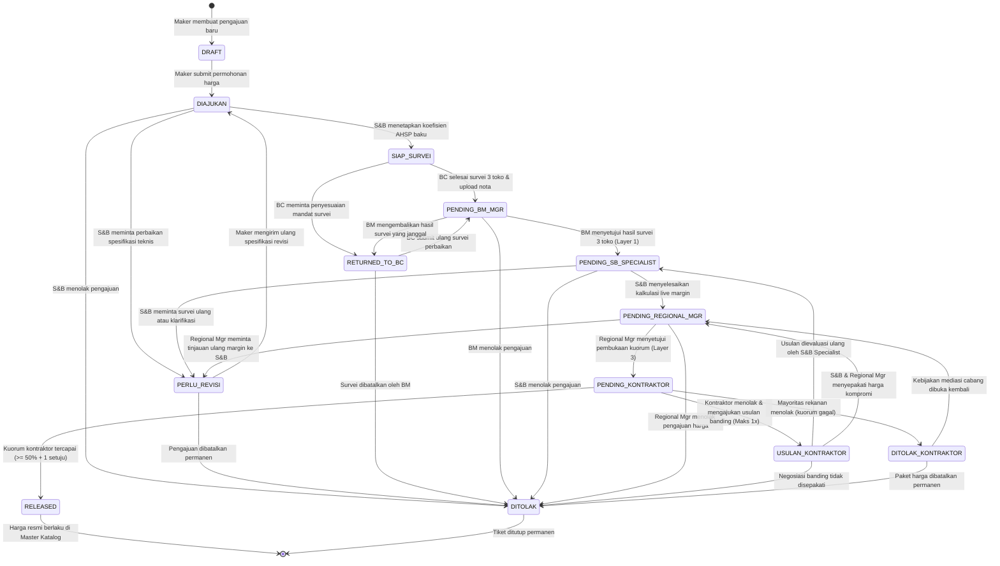
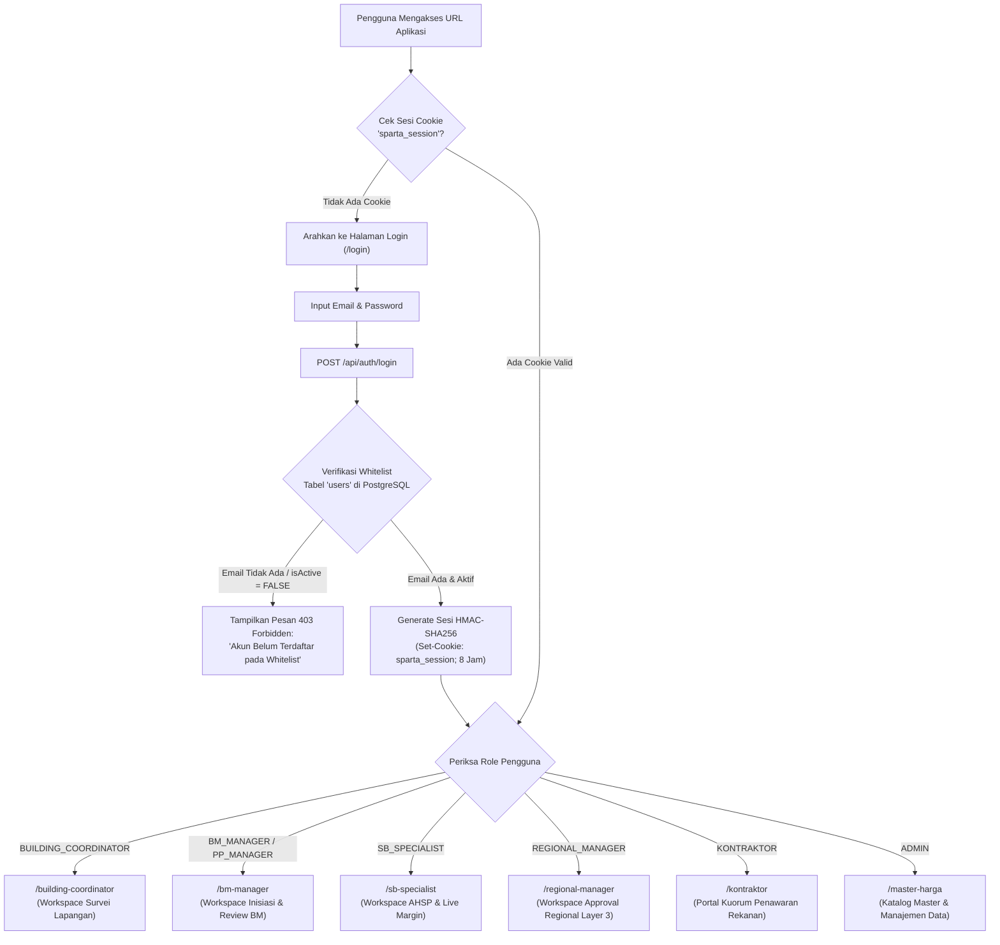
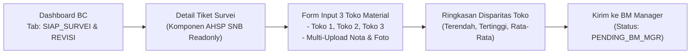
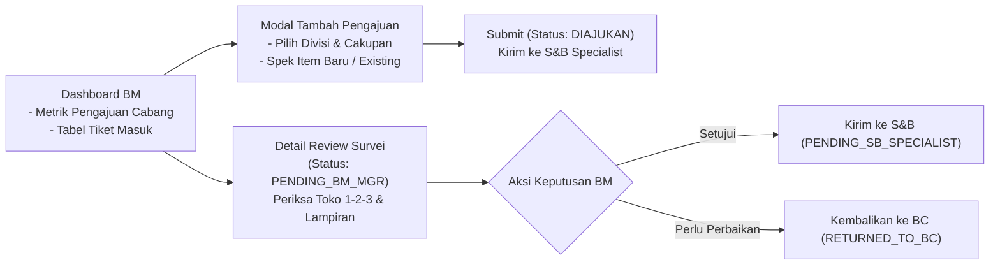
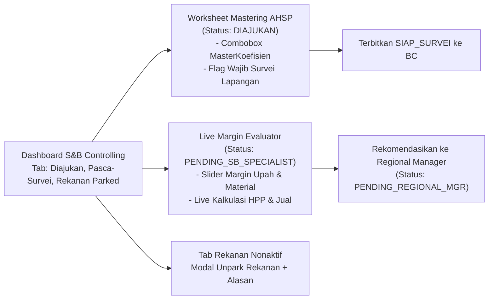
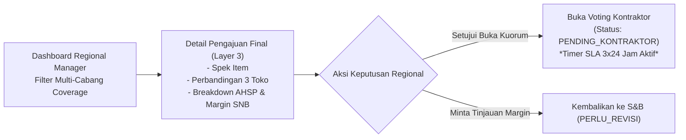
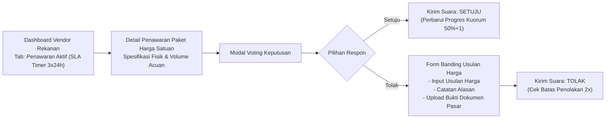
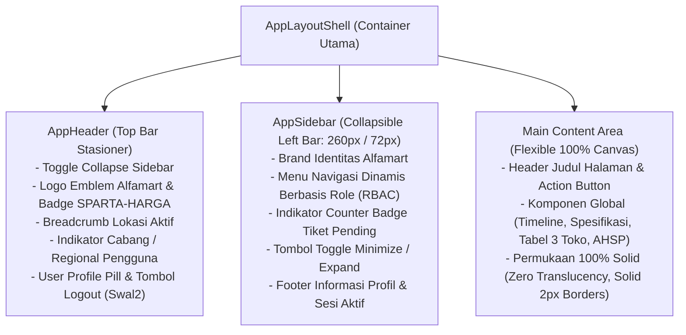
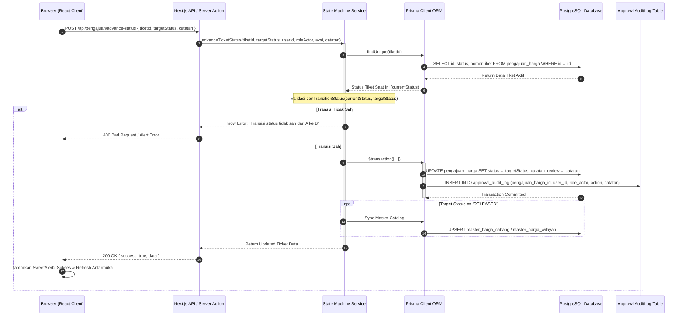

# Master Blueprint: Flow Bisnis & Flow Aplikasi SPARTA-HARGA (`flow-bisnis-dan-aplikasi.md`)

> [!IMPORTANT]
> Dokumen ini adalah **Single Source of Truth (SSOT)** untuk **Alur Proses Bisnis (Business Process Flow)** dan **Alur Interaksi Sistem Aplikasi (Application Architecture & UI Navigation Flow)** sistem **SPARTA-HARGA** (*Sistem Pengelolaan Master Harga Satuan, Survei Pasar & Kuorum Rekanan*). Dokumen ini melengkapi `project-spec.md` dan `database-schema-erd.md` sebagai acuan desain sebelum dan selama implementasi kode.

---

## 1. Ringkasan Eksekutif & Struktur Matriks Peran

Sistem **SPARTA-HARGA** dirancang untuk mengotomasi siklus hidup penetapan harga satuan material, upah, alat, dan pekerjaan di seluruh cabang dan sub-wilayah Alfamart pada 4 divisi operasional (**Building**, **Engineering**, **Maintenance**, **DC**).

### Matriks Aktor & Ruang Lingkup Wewenang

| Peran (Role) | Entitas Organisasi | Tanggung Jawab Utama dalam Alur Sistem |
| :--- | :--- | :--- |
| **B&M Manager / PP Manager** (`BM_MANAGER` / `PP_MANAGER`) | Cabang (*Branch*) | Menginisiasi pengajuan item baru atau update harga existing, serta melakukan review hasil survei 3 toko fisik (*Layer 1 Review*). |
| **S&B Specialist** (`SB_SPECIALIST`) | Kantor Pusat (*Head Office*) | Memvalidasi spesifikasi, menyusun resep koefisien AHSP baku (*MasterKoefisien*) sebelum survei dilakukan, mengatur *live margin*, mengevaluasi usulan banding kontraktor, dan melakukan *unpark* rekanan. |
| **Building Coordinator** (`BUILDING_COORDINATOR`) | Cabang (*Branch*) | Menerima instruksi survei yang sudah memiliki resep AHSP, melakukan survei fisik ke 3 toko material di cabang/wilayah setempat, mengunggah bukti nota & foto fisik, dan mengirimkan hasil survei ke BM. |
| **Regional Manager** (`REGIONAL_MANAGER`) | Regional (*Multi-Cabang*) | Melakukan verifikasi dan persetujuan tingkat manajerial regional (*Layer 3 Approval*), menerbitkan paket harga ke kuorum rekanan kontraktor, serta aksi *unpark* rekanan. |
| **Rekanan Kontraktor** (`KONTRAKTOR`) | Eksternal Vendor | Menerima penawaran harga resmi cabang, melakukan voting persetujuan (kuorum 50%+1) dalam SLA 3×24 jam, mengajukan usulan banding (maksimal 1x), dan berisiko dinonaktifkan sementara (*parked*) jika menolak 2x berturut-turut. |
| **Sistem Otomatis (Engine)** | Server / Database | Menghitung kuorum secara otomatis, memantau batas waktu SLA voting (3×24 jam), mencatat *audit log*, mengunci status *auto-parking*, dan menyinkronkan harga rilis ke katalog master. |

---

## 2. Diagram Alur Proses Bisnis (Business Process Swimlane Flow)

Diagram alur berikut menggambarkan alur kerja lintas-peran dari inisiasi pengajuan tiket hingga harga resmi dirilis (*RELEASED*) ke dalam katalog Master Harga Cabang dan Wilayah.

```mermaid
flowchart TD
    %% Subgraphs Peran
    subgraph S_BM["B&M / PP MANAGER (Cabang)"]
        BM_Start(["Mulai Inisiasi Pengajuan"]) --> BM_Form["1. Input Form Permohonan Harga\n- Pilih Divisi (BLD/ENG/MNT/DC)\n- Tentukan Cabang & Cakupan (Induk / Khusus Wilayah)\n- Tipe: Item Baru vs Update Existing\n- Detail Spek: Ukuran, Merk, Tipe, Lokasi"]
        BM_Form --> BM_Submit["Submit Pengajuan (Status: DIAJUKAN)"]
        BM_Review["5. Review Hasil Survei Toko (Layer 1)\n- Bandingkan Disparitas Harga 3 Toko\n- Cek Keabsahan Bukti Nota & Foto Toko"]
        BM_Decision{"Keputusan BM?"}
        BM_Approve["Setujui Hasil Survei\n(Status: PENDING_SB_SPECIALIST)"]
        BM_Reject["Kembalikan ke BC\n(Status: RETURNED_TO_BC)"]
    end

    subgraph S_SNB["S&B SPECIALIST (Head Office)"]
        SNB_Validasi{"2. Validasi Spek Teknis Awal?"}
        SNB_DraftKoef["3. Susun Lembar Kerja AHSP\n- Pilih Komponen Baku dari Combobox MasterKoefisien\n- Tambah Komponen Baru jika Belum Ada di Master\n- Tetapkan Komponen Wajib Survei Lapangan\n- Tentukan Formula Koefisien Baku"]
        SNB_ReadySurvei["Terbitkan Tiket untuk Survei Lapangan\n(Status: SIAP_SURVEI)"]
        SNB_MarginReview["6. Evaluasi Pasca-Survei & Live Margin\n- Evaluasi Rata-Rata Harga Pasar\n- Simulasikan Slider Margin (Upah, Material, Bongkaran)\n- Rumuskan Rekomendasi Harga Final"]
        SNB_PassToReg["Kirim Rekomendasi ke Regional Manager\n(Status: PENDING_REGIONAL_MGR)"]
        SNB_BandingEval["9. Evaluasi Usulan Banding Kontraktor\n- Analisis Selisih Harga Usulan Vendor\n- Periksa Lampiran Justifikasi Pasar Vendor"]
        SNB_BandingDecision{"Terima Usulan Banding?"}
        SNB_AdjustPrice["Revisi Harga & Rekomendasikan Ulang\n(Status: PENDING_REGIONAL_MGR)"]
        SNB_RejectBanding["Tolak Banding Kontraktor\n(Status: DITOLAK_KONTRAKTOR)"]
    end

    subgraph S_BC["BUILDING COORDINATOR (Cabang)"]
        BC_Pickup["4. Ambil Tiket Siap Survei\n(Resep AHSP sudah dikunci S&B)"]
        BC_Survei["Lakukan Survei Fisik 3 Toko Pasar\n- Datangi 3 Toko Material Lokal\n- Catat Harga Satuan Barang Acuan\n- Ambil Foto Fisik Toko & Minta Struk/Nota Asli"]
        BC_Upload["Input Data Survei & Multi-Upload Berkas\n- Toko 1, Toko 2, Toko 3\n- Upload Foto Nota Pembelian & Tampak Toko"]
        BC_SubmitSurvei["Kirim ke B&M Manager\n(Status: PENDING_BM_MGR)"]
    end

    subgraph S_REG["REGIONAL MANAGER (Jabodetabek / Jawa / Luar Jawa)"]
        REG_Review{"7. Review Layer 3 (Persetujuan Akhir)?"}
        REG_ApproveKuorum["Setujui Pembukaan Kuorum Kontraktor\n(Status: PENDING_KONTRAKTOR)\n*Mulai Countdown SLA 3x24 Jam*"]
        REG_RejectTiket["Tolak / Minta Revisi S&B\n(Status: PERLU_REVISI / DITOLAK)"]
    end

    subgraph S_KTR["REKANAN KONTRAKTOR CABANG (Vendor)"]
        KTR_Receive["8. Terima Penawaran Paket Harga Resmi\n- Periksa Rincian Pekerjaan & Harga Satuan\n- Lihat Batas Waktu Voting SLA (3x24 Jam)"]
        KTR_Vote{"Keputusan Voting Rekanan?"}
        KTR_Setuju["Vote: SETUJU"]
        KTR_Tolak["Vote: TOLAK\n- Input Usulan Harga Alternatif\n- Tulis Catatan Argumentasi\n- Upload Berkas Justifikasi Harga Pasar"]
    end

    subgraph S_SYS["SISTEM & CATALOG MASTER HARGA"]
        SYS_QuorumCheck{"Evaluasi Kuorum Kontraktor\n(Suara Setuju >= 50% + 1?)"}
        SYS_AutoRelease["Auto-Release Penetapan Harga!\n(Status: RELEASED)\n- Catat Riwayat Audit Rilis"]
        SYS_SyncCatalog["Sinkronisasi ke Master Katalog:\n- MasterHargaCabang (Harga Induk)\n- MasterHargaWilayah (Override Khusus)"]
        SYS_EndSuccess(["Selesai: Harga Resmi Aktif"])
        SYS_ParkCheck{"Apakah Kontraktor\nMenolak 2x Berturut-turut?"}
        SYS_AutoPark["Auto-Parking Kontraktor:\n- Set statusKeaktifan = NONAKTIF_SEMENTARA\n- Catat item pemicu & tanggal dinonaktifkan\n*Memerlukan Mediasi Offline & Aksi Unpark*"]
        SYS_HasBanding{"Ada Usulan Banding\n(Maksimal 1 Kali)?"}
    end

    %% Hubungan Alur (Edge Connections)
    BM_Submit --> SNB_Validasi
    SNB_Validasi -- "Spesifikasi Valid" --> SNB_DraftKoef
    SNB_Validasi -- "Spesifikasi Tidak Lengkap" --> BM_Form
    SNB_DraftKoef --> SNB_ReadySurvei
    SNB_ReadySurvei --> BC_Pickup

    BC_Pickup --> BC_Survei
    BC_Survei --> BC_Upload
    BC_Upload --> BC_SubmitSurvei
    BC_SubmitSurvei --> BM_Review

    BM_Review --> BM_Decision
    BM_Decision -- "Disetujui" --> BM_Approve
    BM_Decision -- "Data Toko Kurang / Janggal" --> BM_Reject
    BM_Reject --> BC_Survei
    BM_Approve --> SNB_MarginReview

    SNB_MarginReview --> SNB_PassToReg
    SNB_PassToReg --> REG_Review
    REG_Review -- "Disetujui" --> REG_ApproveKuorum
    REG_Review -- "Ditolak / Margin Terlalu Tinggi" --> REG_RejectTiket
    REG_RejectTiket --> SNB_MarginReview

    REG_ApproveKuorum --> KTR_Receive
    KTR_Receive --> KTR_Vote
    KTR_Vote -- "Setuju" --> KTR_Setuju
    KTR_Vote -- "Tolak" --> KTR_Tolak

    KTR_Setuju --> SYS_QuorumCheck
    KTR_Tolak --> SYS_ParkCheck

    SYS_ParkCheck -- "Ya (Penolakan ke-2)" --> SYS_AutoPark
    SYS_ParkCheck -- "Tidak (Penolakan ke-1)" --> SYS_HasBanding

    SYS_HasBanding -- "Ada Usulan Harga" --> SNB_BandingEval
    SYS_HasBanding -- "Tidak Ada Usulan" --> SYS_QuorumCheck

    SNB_BandingEval --> SNB_BandingDecision
    SNB_BandingDecision -- "Usulan Masuk Akal" --> SNB_AdjustPrice
    SNB_BandingDecision -- "Usulan Tidak Masuk Akal" --> SNB_RejectBanding
    SNB_AdjustPrice --> REG_Review
    SNB_RejectBanding --> SYS_QuorumCheck

    SYS_QuorumCheck -- "Kuorum Tercapai (>= 50% + 1)" --> SYS_AutoRelease
    SYS_QuorumCheck -- "Kuorum Gagal / Menolak Mayoritas" --> REG_RejectTiket
    SYS_AutoRelease --> SYS_SyncCatalog
    SYS_SyncCatalog --> SYS_EndSuccess
```

---

## 3. Diagram State Machine Siklus Hidup Tiket (`StatusPengajuanHarga`)

Diagram state machine berikut merepresentasikan aturan transisi status tiket secara ketat (*deterministic state transitions*) yang divalidasi oleh [`src/lib/services/state-machine.ts`](file:///c:/Users/UDevran/Documents/Sumber%20Alfaria%20Trijaya/system/master-harga-app/src/lib/services/state-machine.ts).

---

## 4. Diagram Alur Aplikasi & Navigasi Layar (Application Flow & Screen Navigation)

### 4.1. Alur Autentikasi Zero-Trust & Route Protection

Setiap akses menuju modul SPARTA-HARGA dilindungi oleh Edge Middleware ([`src/middleware.ts`](file:///c:/Users/UDevran/Documents/Sumber%20Alfaria%20Trijaya/system/master-harga-app/src/middleware.ts)). Pengguna tidak dapat memilih role secara manual.

---

### 4.2. Navigasi Layar Per Peran Pengguna (Screen-to-Screen User Journey)

#### A. Building Coordinator (`/building-coordinator`)

#### B. B&M Manager / PP Manager (`/bm-manager`)

#### C. S&B Specialist (`/sb-specialist`)

#### D. Regional Manager (`/regional-manager`)

#### E. Rekanan Kontraktor (`/kontraktor`)

---

### 4.3. Arsitektur Layout Halaman Global: Collapsible Sidebar & Header Shell

Seluruh modul kerja operasional (BC, BM, S&B, Regional, dan Kontraktor) menggunakan kerangka tata letak terpadu **Enterprise Collapsible Sidebar + Top Header Bar** (`AppLayoutShell`):

#### A. Pemetaan Menu Navigasi Sidebar Dinamis per Role (RBAC Menu Matrix)

| Peran (Role) | Item Menu Utama di Sidebar | Rute URL | Ikon & Badge Indikator |
| :--- | :--- | :--- | :--- |
| **Building Coordinator** | • Antrean Siap Survei • Survei Perbaikan • Master Toko Cabang | `/building-coordinator` `/building-coordinator/revisi` `/building-coordinator/master-toko` | 📋 Badge Merah tiket siap survei ⚠️ Badge Kuning tiket dikembalikan 🏪 Direktori toko lokal |
| **B&M / PP Manager** | • Dashboard Tiket Cabang • Buat Pengajuan Baru • Review Hasil Survei • Katalog Harga Resmi | `/bm-manager` `/bm-manager/buat-pengajuan` `/bm-manager/review-survei` `/bm-manager/katalog-harga` | 📊 Ringkasan metrik cabang ➕ Modal penetapan harga 🔍 Badge Kuning tiket survei selesai 🏷️ Harga aktif cabang & wilayah |
| **S&B Specialist** | • Antrean Mastering AHSP • Evaluasi Live Margin • Usulan Banding Rekanan • Rekanan Nonaktif (*Parked*) • Pustaka Koefisien Baku • Master Spesifikasi Item | `/sb-specialist` `/sb-specialist/evaluasi-margin` `/sb-specialist/banding-rekanan` `/sb-specialist/rekanan-parked` `/sb-specialist/master-koefisien` `/sb-specialist/master-item` | 📐 Badge Biru tiket diajukan ⚖️ Badge Kuning tiket pasca-survei 🗳️ Badge Merah tiket banding 🚫 Badge Merah rekanan parked 📚 Combobox library koefisien 📦 Katalog spek bahan/jasa |
| **Regional Manager** | • Dashboard Approval Regional • Monitoring Kuorum Rekanan • Rekanan Nonaktif Regional • Katalog Master Regional | `/regional-manager` `/regional-manager/monitoring-kuorum` `/regional-manager/rekanan-parked` `/regional-manager/katalog-harga` | 🛡️ Badge Merah pengajuan Layer 3 ⏱️ Badge Biru kuorum aktif SLA 3x24h 🚫 Daftar rekanan parked cabang 🏷️ Direktori harga regional |
| **Rekanan Kontraktor** | • Penawaran Kuorum Aktif • Riwayat Partisipasi Voting | `/kontraktor` `/kontraktor/riwayat` | ⏱️ Badge Merah voting aktif SLA 📜 Arsip keputusan harga vendor |
| **Super Admin** | • Manajemen Whitelist User • Struktur Divisi & Cabang • Audit Logs Transaksi | `/admin/users` `/admin/organisasi` `/admin/audit-logs` | 👥 Whitelist zero-trust 🏢 Konfigurasi wilayah & cabang 📜 Log persetujuan sistem |

#### B. Standar Visual & Anti-Slop Layout
1. **100% Solid Surfaces & Tangible Borders**:
   - Sidebar menggunakan `bg-white` dengan batas kanan `border-r-2 border-slate-200`.
   - Top Header menggunakan `bg-white` dengan batas bawah ganda identitas Alfamart (`border-b-2 border-slate-200` + pita aksen merah & kuning).
   - Dilarang menggunakan efek *glassmorphism* atau *backdrop blur*.
2. **Solid Bold Badges & Active States**:
   - Menu aktif ditandai dengan latar solid Alfa Blue (`bg-[#005BAC] text-white font-bold`).
   - Badge counter menggunakan warna solid kontras tinggi (`bg-[#ED1C24] text-white font-bold` untuk urgensi tinggi, `bg-[#005BAC] text-white font-bold` untuk info antrean).
3. **SweetAlert2 untuk Logout & Aksi Kritis**:
   - Seluruh dialog konfirmasi logout atau aksi pembatalan wajib memicu `Swal.fire(...)` dengan tombol solid high-contrast.

---

## 5. Diagram Interaksi & Alur Data Sistem (System Integration Sequence Diagram)

Diagram sequence berikut menunjukkan interaksi komponen mulai dari browser client, Server Action/API Route, validasi aturan bisnis *state machine*, Prisma ORM, hingga database PostgreSQL:

---

## 6. Validasi & Checklist Kepatuhan SDLC

Dokumen ini menjamin bahwa seluruh tahapan analisis kebutuhan dan perancangan telah terpenuhi sebelum tahapan penulisan kode fitur berlanjut:

- [x] **Identifikasi Aktor & Tanggung Jawab**: 5 peran pengguna internal & eksternal terdefinisi tanpa celah wewenang.
- [x] **Alur Bisnis End-to-End**: Meliputi inisiasi, penetapan AHSP, survei 3 toko, live margin, approval 3 lapis, kuorum rekanan, auto-parking, unparking, hingga sinkronisasi master harga.
- [x] **Penanganan Pengecualian (Exception Flows)**: Alur penolakan, pengembalian survei, banding harga kontraktor, dan mediasi offline terdokumentasi.
- [x] **Aturan FSM (Deterministic State Machine)**: Seluruh status tiket dan rute transisinya telah dipetakan secara matematis.
- [x] **Navigasi Layar (User Journey)**: Struktur layar untuk masing-masing role telah terpetakan sesuai direktori rute Next.js App Router.
- [x] **Zero-Trust Security**: Alur autentikasi whitelist lokal dan penolakan 403 terintegrasi dalam arsitektur sistem.
