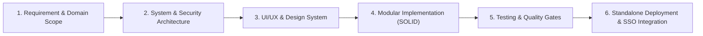
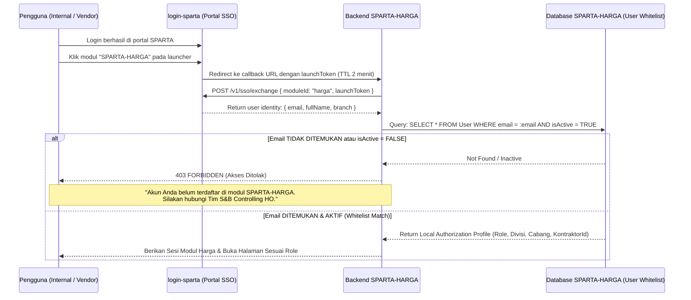
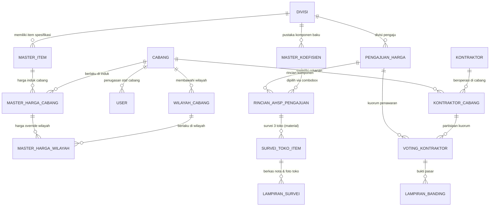

# Master Project Specification & SDLC Blueprint: SPARTA-HARGA (`project-spec.md`)

> [!IMPORTANT]
> Dokumen ini merupakan **Single Source of Truth (SSOT)** rekayasa perangkat lunak untuk aplikasi mandiri **SPARTA-HARGA** (*Sistem Pengelolaan Master Harga, Survei Pasar & Kuorum Rekanan*), disusun berdasarkan tahapan **SDLC (Software Development Life Cycle)** dan prinsip **Software Engineering Standards (SOLID, Clean Architecture, dan Zero-Trust Security)**.

---

## Siklus Hidup Pengembangan Sistem (SDLC Overview)

---

## Bagian 1: Identitas Proyek & Analisis Kebutuhan (SDLC Phase 1)

### 1.1 Identitas Sistem
| Atribut | Detail Spesifikasi |
| :--- | :--- |
| **Nama Resmi Sistem** | **SPARTA-HARGA** (*Sistem Pengelolaan Master Harga Satuan, Survei Pasar & Kuorum Rekanan*) |
| **Organisasi / Pemilik** | PT Sumber Alfaria Trijaya Tbk (Alfamart) |
| **Cakupan Divisi** | **Building** (Sipil/Konstruksi), **Engineering** (ME/HVAC), **Maintenance**, dan **DC** (*Distribution Center*) |
| **Tipe Aplikasi** | Aplikasi Web Enterprise Mandiri (*Standalone Multi-Role Web Application*) |
| **Repositori Proyek** | `master-harga-app` |

### 1.2 Problem Statement & Tujuan Bisnis
1. **Tata Kelola Master Harga Terpusat Lintas Divisi**: Menyediakan satu platform terpadu untuk pengelolaan harga satuan bagi 4 divisi (**Building**, **Engineering**, **Maintenance**, **DC**) dengan Master Cabang yang terintegrasi dan rumus perhitungan baku yang seragam.
2. **Fleksibilitas Harga Wilayah di Dalam Cabang**: Mengakomodasi disparitas harga pada wilayah-wilayah khusus di bawah suatu cabang induk melalui mekanisme pengajuan dan survei 3 toko lokal tersendiri (*sub-branch/wilayah pricing override*).
3. **Pustaka Koefisien Dinamis (Combobox SNB)**: Memberikan fleksibilitas bagi S&B Specialist/HO untuk memilih koefisien standar yang sudah ada atau menambahkan komponen koefisien baru secara instan langsung dari *combobox*.
4. **Disiplin Kuorum Rekanan (50% + 1) & Auto-Parking**: Menerapkan batas waktu SLA (3×24 jam) bagi kontraktor untuk voting harga. Kontraktor yang menolak 2x berturut-turut otomatis dinonaktifkan sementara (*parked*) di cabang terkait, dengan mediasi yang diselesaikan di luar sistem dan pemulihan status (*unpark*) langsung melalui sistem.
5. **Keamanan Berbasis Whitelist Ketat**: Akses modul harga hanya dapat dimasuki oleh pengguna yang telah didaftarkan dan diatur hak wewenangnya oleh administrator (*zero auto-provisioning*).

---

## Bagian 2: Tech Stack & Rationale Pilihan Dependensi (SDLC Phase 2)

| Kategori | Teknologi / Library | Versi Target | Rationale (Alasan Pemilihan) |
| :--- | :--- | :--- | :--- |
| **Package Manager** | **pnpm** | `11.8.0` | Cepat, hemat *disk space* via *content-addressable store*, dan menjamin resolusi dependensi yang ketat (*strict dependency resolution*). |
| **Core Framework** | **Next.js (App Router)** | `16.2.x` | Menggunakan struktur `src/app/`, mendukung Server & Client Components, Route Handlers, dan performa tinggi. |
| **Bahasa Pemrograman** | **TypeScript** (`strict: true`) | `6.0.x` | Menjamin *type-safety* mutlak pada rumus kalkulasi AHSP, koefisien, margin, dan transaksi kuorum. |
| **Database & ORM** | **PostgreSQL + Prisma ORM** | `7.8.x` | Menangani relasi relasional kompleks (Cabang, Wilayah, Kontraktor, AHSP, Survei 3 Toko) dengan tipe `Decimal` presisi tinggi. |
| **Global State (Client)** | **Redux Toolkit (RTK) + React-Redux** | `2.x / 9.x` | Mengelola *normalized relational state* (Kontraktor ↔ Cabang ↔ Status Parked) pada antarmuka frontend secara reaktif. |
| **Styling Engine** | **Tailwind CSS** | `v4` | Desain berakar pada warna resmi Alfamart (HEX Solid `#005BAC`, `#ED1C24`, `#FFD100` & Pastel Tints) via `@theme inline`. |
| **Identitas Autentikasi** | **Integrasi SSO `login-sparta`** | Service Contract | Menerima identitas terverifikasi via `/v1/sso/exchange` dari portal login terpusat SPARTA. |

---

## Bagian 3: Arsitektur Keamanan & Integrasi SSO (Zero-Trust Whitelist)

### 3.1 Alur Autentikasi & Validasi Whitelist (Zero Auto-Provisioning)

Modul **SPARTA-HARGA** mengadopsi prinsip **Zero-Trust Authorization**. Modul ini **tidak mengizinkan auto-provisioning / auto-sync** pengguna baru dari portal login:

### 3.2 Aturan Otorisasi Lokal
1. **Pre-Registration oleh Administrator / HO**:
   - Setiap pengguna yang berhak mengakses SPARTA-HARGA wajib didaftarkan terlebih dahulu oleh admin S&B Controlling HO pada tabel `User`.
   - Data yang dikunci: `email`, `role`, `divisiId`, `cabangId`, serta `kontraktorId` (khusus role vendor).
2. **Pembeda Pengguna Internal vs Vendor Kontraktor**:
   - **Internal (S&B, B&M, PP, BC, Engineering, Maintenance, DC)**: Kolom `kontraktorId` bernilai **`NULL`**.
   - **Eksternal (Kontraktor Rekanan)**: Kolom `kontraktorId` terisi merujuk ke tabel `Kontraktor`, sehingga saat login ia hanya berhak melihat dan merespons kuorum yang ditujukan kepada PT-nya sendiri.
3. **Multi-Cabang Coverage (`UserCabangCoverage`)**:
   - Untuk role tingkat regional seperti **B&M Regional Manager** atau **S&B Specialist**, cabang wewenang dicatat pada tabel `UserCabangCoverage` sehingga satu akun login dapat mengelola persetujuan di banyak cabang sekaligus.

---

## Bagian 4: Arsitektur Data Relasional & Domain Model (SDLC Phase 2)

### 4.1 Entitas Inti Sistem

### 4.2 Aturan Bisnis Kunci (Business Rules)
1. **Multi-Divisi & Master Koefisien (Combobox SNB)**:
   - Divisi **Building**, **Engineering**, **Maintenance**, dan **DC** menggunakan rumus perhitungan seragam:
     $$\text{Subtotal Komponen} = (\text{Nilai Koefisien} \times \text{Harga Acuan}) \times \left(1 + \frac{\text{Margin \%}}{100}\right)$$
   - Komponen koefisien dikelola terpusat pada `MASTER_KOEFISIEN`. Pada lembar kerja SNB, komponen dipilih melalui *combobox* dengan fitur *creatable* (dapat langsung menambahkan komponen baru ke master).
2. **Harga Wilayah di Dalam Cabang via Survei 3 Toko**:
   - Jika suatu wilayah di bawah cabang memiliki disparitas harga, pengajuan dibuat dengan menentukan `wilayahCabangId` (`cakupanHarga = KHUSUS_WILAYAH`) dan wajib menginput **Survei 3 Toko (`SurveiTokoItem`)** di wilayah tersebut.
   - Saat disahkan, harga resmi tersimpan di `MasterHargaWilayah` sebagai *override* terhadap harga induk cabangnya.
3. **Multi-Upload Bukti Survei (`LampiranSurvei`)**:
   - Setiap toko yang disurvei dapat dilampiri beberapa dokumen/foto (foto nota/struk, foto fisik toko, dan foto sampel barang) yang tersimpan di tabel `LampiranSurvei`.
4. **Penyederhanaan Rekanan Nonaktif (*Parked*)**:
   - Kontraktor yang menolak 2x berturut-turut otomatis dinonaktifkan sementara di cabang terkait (`statusKeaktifan = NONAKTIF_SEMENTARA`).
   - Mediasi diselesaikan di luar sistem (offline). Pada sistem, antarmuka menyediakan daftar rekanan *parked* dengan aksi tunggal tombol **"Aktifkan Kembali" (*Unpark*)** oleh role yang berwenang.

---

## Bagian 5: Matriks Akses Peran (RBAC Matrix)

| Fitur / Modul Fungsional | BC (Cabang) | B&M / PP Mgr | S&B Specialist | Regional Mgr | Kontraktor |
| :--- | :---: | :---: | :---: | :---: | :---: |
| Input Pengajuan Harga & Survei 3 Toko | ✅ Buat/Edit | 👁️ Lihat | 👁️ Lihat | 👁️ Lihat | ❌ |
| Konfigurasi Koefisien AHSP (Combobox Master) | ❌ | ❌ | ✅ Pilih / Tambah Master | 👁️ Lihat | ❌ |
| Evaluasi Penyesuaian Margin SNB | ❌ | ❌ | ✅ Eksekusi | 👁️ Lihat | ❌ |
| Approval Persetujuan Harga Cabang / Wilayah | ❌ | ❌ | 👁️ Rekomendasi | ✅ Putuskan (Layer 3) | ❌ |
| Voting Penawaran Harga (Kuorum 50% + 1) | ❌ | ❌ | 👁️ Monitor | 👁️ Monitor | ✅ Vote (Maks 1x Banding) |
| Aktifkan Kembali Kontraktor (*Unpark*) | ❌ | ❌ | ✅ Unpark | ✅ Unpark | ❌ |
| Manajemen Whitelist Pengguna & Cabang | ❌ | ❌ | ✅ Kelola Whitelist | 👁️ Lihat | ❌ |

---

## Bagian 6: Sitemap & Struktur Halaman Frontend

| No | Modul / Halaman | Rute URL | Deskripsi Fungsionalitas | Prioritas |
| :---: | :--- | :--- | :--- | :---: |
| **01** | **Callback SSO Handler** | `/auth/sso/callback` | Menerima launchToken dari `login-sparta`, memverifikasi whitelist lokal, membuat sesi, dan auto-redirect sesuai role wewenang. | 🔴 P1 |
| **02** | **Modul B&M Manager** | `/bm-manager` | Inisiasi permohonan penetapan harga baru atau update existing (`ModalRequestPenetapanHarga`), review hasil survei cabang (Layer 1). | 🔴 P1 |
| **03** | **Modul Building Coordinator** | `/building-coordinator` | Workspace tiket `SIAP_SURVEI` (membaca komponen dari resep AHSP SNB), form survei 3 toko pasar & multi-upload berkas lampiran. | 🔴 P1 |
| **04** | **Modul S&B Controlling** | `/sb-specialist` | Validasi spesifikasi awal, worksheet mastering AHSP (combobox koefisien baku), penyesuaian live margin pasca-survei, dan unpark kontraktor. | 🔴 P1 |
| **05** | **Modul Regional Manager** | `/regional-manager` | Persetujuan akhir harga reguler (Layer 3), keputusan banding per cabang, dan aksi unpark kontraktor. | 🔴 P1 |
| **06** | **Portal Rekanan Kontraktor** | `/kontraktor` | Antarmuka eksternal bagi rekanan untuk voting kuorum 50%+1 (SLA 3x24 jam) dan pengajuan usulan harga/lampiran bukti pasar. | 🔴 P1 |
| **07** | **Katalog Master Harga** | `/master-harga` | Direktori resmi harga satuan aktif per cabang dan harga khusus wilayah (*override*). | 🟡 P2 |
| **08** | **Master Toko & Survei** | `/master-survei` | Direktori master toko rekanan survei pasar, riwayat survei toko, dan tracker status. | 🟡 P2 |

---

## Bagian 7: Standar Kualitas & Quality Gates (`pnpm`)

- **Development Server**: `pnpm dev`
- **Typecheck (Mandatory Gate)**: `pnpm exec tsc --noEmit` (Wajib menghasilkan **0 error**).
- **Linter**: `pnpm lint`
- **Database Tooling**: `pnpm db:generate`, `pnpm db:push`, `pnpm db:seed`
