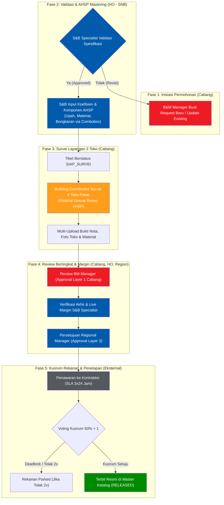
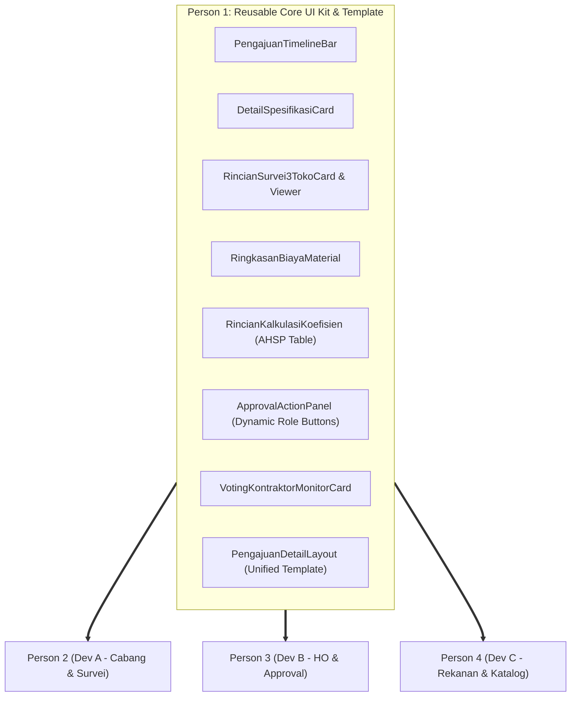

# Master Task Breakdown & Implementation Blueprint: SPARTA-HARGA (`task-breakdown.md`)

> [!IMPORTANT]
> Dokumen ini merupakan panduan operasional pembagian tugas rekayasa perangkat lunak untuk tim pengembang **SPARTA-HARGA** (4 orang Fullstack, termasuk Tech Lead). Seluruh implementasi berpegang teguh pada prinsip **Clean Architecture**, **Vertical Slice Ownership**, **Zero-Trust Whitelist Security**, serta **Pemusatan Komponen Reusable**.

---

## 1. Arsitektur Siklus Hidup Alur Kerja Bisnis (End-to-End Workflow)

Urutan alur penetapan harga satuan dilakukan secara sekuensial dan terstruktur:

---

## 2. Strategi Kolaborasi: Pemusatan Komponen Reusable

Untuk mencegah duplikasi kode ribuan baris pada halaman approval (`bm-manager/[id]`, `sb-specialist/[id]`, `regional-manager/[id]`), seluruh komponen tampilan dan template halaman detail dipusatkan kepada **Person 1 (Tech Lead)**:

---

## 3. Rincian Pembagian Tugas Per Pengembang (Vertical Slice)

### 3.1 Person 1: Tech Lead, Core Platform & Reusable UI Kit (Anda)

* **Tanggung Jawab Utama**: Arsitektur fondasi, gerbang keamanan SSO Whitelist, Seeder data master, pustaka komponen reusable, dan template halaman detail approval.
* **Daftar Tugas Spesifik**:
  - [ ] **SSO Whitelist & Auth Guard**:
    - Route handler `/api/auth/sso/callback`: integrasi token exchange dengan `login-sparta` (`POST /v1/sso/exchange`).
    - Validasi tabel `User` (*Zero Auto-Provisioning*). Return `403 Forbidden` jika email tidak terdaftar di database.
    - Session management (Cookie/JWT) dan middleware Next.js untuk proteksi rute serta **auto-redirect langsung ke workspace peran** (tanpa selector peran manual):
      - `BUILDING_COORDINATOR` $\rightarrow$ `/building-coordinator`
      - `BM_MANAGER` $\rightarrow$ `/bm-manager`
      - `SB_SPECIALIST` $\rightarrow$ `/sb-specialist`
      - `REGIONAL_MANAGER` $\rightarrow$ `/regional-manager`
      - `KONTRAKTOR` $\rightarrow$ `/kontraktor`
  - [ ] **Shared Shell & Layout**:
    - `AppNavbar` resmi dengan logo Alfamart, user badge, cabang aktif, dan tombol logout.
    - Global Alert / Toast Notification Provider dan dialog konfirmasi bersama.
    - Integrasi token warna resmi Alfamart (HEX `#005BAC`, `#ED1C24`, `#FFD100`).
  - [ ] **Pustaka Komponen Reusable Domain (`src/components/shared/`)**:
    - `PengajuanTimelineBar`: Progress stepper status siklus hidup tiket.
    - `DetailSpesifikasiCard`: Kartu ringkasan identitas pekerjaan/material.
    - `RincianSurvei3TokoCard`: Kartu tampilan survei 3 toko + modal viewer berkas nota/foto.
    - `RingkasanBiayaMaterial`: Tabel harga acuan hasil survei pasar.
    - `RincianKalkulasiKoefisien`: Tabel kalkulasi AHSP (mendukung mode *read-only* atau *editable*).
    - `ApprovalActionPanel`: Panel aksi dinamis menerima props `role` dan `status` untuk merender tombol keputusan (Setuju, Revisi, Tolak, dll.) dan form catatan.
    - `VotingKontraktorMonitorCard`: Kartu pemantauan kuorum rekanan 50%+1.
  - [ ] **Unified Detail Template (`PengajuanDetailLayout`)**:
    - Satu layout universal yang merakit komponen-komponen di atas dengan slot aksi dinamis sesuai peran.
  - [ ] **Database Seeder & State Machine Service**:
    - Script `prisma/seed.ts` (Divisi, Cabang, Wilayah, Kategori, User Whitelist test).
    - Helper transisi status tiket terpusat (`StatusPengajuanHarga`).

---

### 3.2 Person 2: Operasional Cabang & Survei Lapangan (Dev A)

* **Tanggung Jawab Utama**: Alur inisiasi permohonan cabang, survei fisik 3 toko pasar, multi-upload berkas bukti, dan hirarki wilayah.
* **Daftar Tugas Spesifik**:
  - [ ] **Inisiasi Request B&M Manager (`/bm-manager`)**:
    - Form pembuatan tiket request baru atau update item existing (`ModalRequestPenetapanHarga`).
    - Validasi duplikasi kode/spesifikasi item di cabang.
    - Dashboard monitoring tiket cabang dengan filter status (`DIAJUKAN`, `PERLU_REVISI`, dll.).
  - [ ] **Workspace Building Coordinator (`/building-coordinator`)**:
    - Halaman daftar tiket survei (Tab: *Siap Survei*, *Diproses*, *Selesai*).
    - Menampilkan daftar material yang wajib disurvei (membaca resep komponen hasil mastering S&B).
  - [ ] **Formulir Survei 3 Toko Pasar (`/building-coordinator/[id]`)**:
    - Form pengisian data survei 3 toko (Nama toko, alamat, kota, kontak, tanggal, harga survei).
    - Validasi minimal 3 toko valid sebelum tiket dapat disubmit ke B&M Manager.
    - Kalkulasi otomatis harga acuan pasar (rata-rata survei 3 toko).
  - [ ] **Multi-Upload Bukti Survei (`LampiranSurvei`)**:
    - Komponen upload berkas per toko (foto nota/struk, foto fisik toko, dan foto material).
    - Endpoint API `/api/survei/upload` untuk penyimpanan file bukti fisik.
  - [ ] **Hirarki Sub-Wilayah Cabang**:
    - Fitur pemilihan cakupan harga (`INDUK_CABANG` vs `KHUSUS_WILAYAH` via `WilayahCabang`).
  - [ ] **Review Layer 1 B&M Manager**:
    - Menghubungkan halaman approval BM Manager dengan `ApprovalActionPanel` (Person 1) untuk aksi setuju ke S&B atau kembalikan ke BC.
  - [ ] **Master Toko & Direktori Survei (`/master-survei`)**:
    - CRUD master data toko material rekanan survei dan riwayat survei toko.

---

### 3.3 Person 3: HO Controlling, AHSP Engine & Regional Approval (Dev B)

* **Tanggung Jawab Utama**: Otak perhitungan AHSP, validasi spesifikasi pra-survei, live margin, dan approval regional.
* **Daftar Tugas Spesifik**:
  - [ ] **Validasi Awal Spesifikasi (Pra-Survei) oleh S&B Specialist**:
    - Halaman verifikasi permohonan tiket B&M Manager (`/sb-specialist`).
    - Aksi keputusan: **Setujui untuk Mastering** vs **Kembalikan Revisi ke BM Manager**.
  - [ ] **Worksheet AHSP & Input Koefisien (Sebelum Survei)**:
    - Antarmuka input rincian koefisien pekerjaan (Upah, Material, Alat, Bongkaran).
    - Integrasi dengan `MasterKoefisien`: dropdown *creatable* yang dapat memilih koefisien baku yang sudah ada atau langsung mengetik untuk menambah komponen baru ke database.
    - Aksi simpan koefisien $\rightarrow$ otomatis mengubah status tiket menjadi **`SIAP_SURVEI`** dan meneruskannya ke Building Coordinator cabang.
  - [ ] **Verifikasi Pasca-Survei & Live Margin Calculator**:
    - Menghubungkan harga acuan hasil survei toko dengan koefisien AHSP:
      $$\text{Subtotal} = (\text{Koefisien} \times \text{Harga Acuan Survei}) \times \left(1 + \frac{\text{Margin \%}}{100}\right)$$
    - Slider dan input interaktif untuk penyesuaian live margin (Upah, Material, Bongkaran).
    - Penanganan kalkulasi seragam untuk 4 divisi: Building, Engineering, Maintenance, dan DC.
  - [ ] **Approval Level 3 Regional Manager (`/regional-manager/[id]`)**:
    - Halaman review regional menggunakan `PengajuanDetailLayout` dan `ApprovalActionPanel` (Person 1).
    - Evaluasi disparitas harga antar-cabang dalam region dan penetapan akhir harga sebelum diteruskan ke kontraktor.
  - [ ] **Audit Trail Engine**:
    - Pencatatan riwayat setiap perubahan koefisien, margin, dan approval ke tabel `RiwayatAuditHarga`.

---

### 3.4 Person 4: Portal Kontraktor, Kuorum & Master Data (Dev C)

* **Tanggung Jawab Utama**: Interaksi rekanan eksternal, kuorum voting, penanganan kontraktor parked, dan katalog harga resmi.
* **Daftar Tugas Spesifik**:
  - [ ] **Portal Rekanan Kontraktor (`/kontraktor` & `/kontraktor/[id]`)**:
    - Antarmuka khusus rekanan dengan isolasi data ketat: kontraktor hanya dapat melihat penawaran cabang yang mengikat PT-nya (`kontraktorId`).
    - Countdown SLA Timer (3×24 jam) untuk merespons penawaran.
    - Aksi voting: **Setuju** vs **Usulkan Banding**.
  - [ ] **Formulir Usulan Banding Kontraktor**:
    - Input nilai harga usulan baru, catatan argumentasi, dan upload berkas bukti pembanding pasar (`LampiranBanding`).
  - [ ] **Kuorum Engine (50% + 1)**:
    - Kalkulasi reaktif persentase voting rekanan aktif per cabang.
    - Aturan otomatisasi penonaktifan: rekanan yang menolak 2x berturut-turut otomatis berstatus `NONAKTIF_SEMENTARA` (*Parked*).
  - [ ] **Manajemen Rekanan Parked**:
    - Tampilan tabel daftar rekanan *parked* per cabang (tanpa log diskusi sistem).
    - Tombol aksi tunggal: **"Aktifkan Kembali" (*Unpark*)** untuk mengembalikan rekanan ke status aktif oleh S&B / Regional Manager.
  - [ ] **Direktori Master Harga Resmi (`/master-harga`)**:
    - Halaman katalog resmi harga satuan yang berstatus `RELEASED`.
    - Tampilan hierarki: harga induk cabang vs penanda khusus (*badge override*) untuk harga wilayah khusus.
    - Filter pencarian, filter kategori pekerjaan, dan fitur ekspor data ke Excel / PDF.

---

## 4. Rencana Jadwal Eksekusi Sprint (Sprint Schedule)

| Periode | Fokus Tim | Target Deliverable Utama |
| :---: | :--- | :--- |
| **Hari 1 - 2** *(Sprint 1: Pondasi & UI Kit)* | **Person 1**: Merampungkan SSO Whitelist, Seed Database, dan seluruh Pustaka Komponen Reusable (`src/components/shared/`). **Person 2, 3, 4**: Menyiapkan struktur form, skema validasi Zod, dan kerangka API Prisma di workspace masing-masing. | Komponen reusable siap pakai diimpor; otentikasi login mock/SSO berjalan; database seeder terpasang. |
| **Hari 3 - 6** *(Sprint 2: Fitur & Logika Bisnis)* | **Person 2**: Form B&M Request, form survei 3 toko BC, upload file, dan master toko. **Person 3**: Worksheet koefisien SNB (creatable), kalkulator AHSP, live margin, dan review approval. **Person 4**: Portal voting kontraktor, kuorum engine, aksi unpark rekanan, dan master katalog harga. | Masing-masing modul berfungsi penuh secara vertikal dan terhubung ke PostgreSQL. |
| **Hari 7 - 8** *(Sprint 3: Integrasi & UAT)* | **Seluruh Tim**: Menghubungkan seluruh siklus rantai status: BM Request $\rightarrow$ SNB Koefisien $\rightarrow$ BC Survei 3 Toko $\rightarrow$ BM Review $\rightarrow$ SNB Margin $\rightarrow$ Reg Mgr Approval $\rightarrow$ Kuorum Kontraktor $\rightarrow$ Released di Master Katalog. | Pengujian alur lengkap lolos tanpa celah; verifikasi `pnpm exec tsc --noEmit` lolos 0 error. |

---

## 5. Standar Rekayasa & Quality Gates

1. **Package Manager**: Wajib menggunakan `pnpm@11.8.0` (dilarang menggunakan `npm` atau `yarn`).
2. **Quality Gate**: Setiap *Pull Request* (PR) wajib lolos `pnpm exec tsc --noEmit` dengan **0 error**.
3. **Standar Desain Alfamart**: Menggunakan warna resmi HEX Solid (`#005BAC`, `#ED1C24`, `#FFD100`) dan pastel tints (hindari `oklch` dan hindari tanda pisah em-dash `—` pada teks antarmuka).
4. **Keamanan**: Menerapkan validasi whitelist ketat (*Zero Auto-Provisioning*) di setiap endpoint API.
